# Dompi Car Dashboard — versione pubblica 0.3.34

Interfaccia PWA per tablet in automobile, sviluppata da Domenico Pizzata.

**Progetto originale:** conservato privatamente. Questa è una copia di distribuzione senza la cronologia di sviluppo.

**Versione online prevista:** https://dompidark.github.io/DompiCarDashboard-Public/

## Come iniziare e installare Dompi Car Dashboard

### Uso online consigliato

Apri la versione pubblica direttamente dal browser:

**https://dompidark.github.io/DompiCarDashboard-Public/**

È il modo più semplice per provare Dompi Car Dashboard senza copiare file sul dispositivo.

### Aggiunta alla schermata Home dell’iPad

1. Apri l’indirizzo della Dashboard con Safari.
2. Tocca **Condividi**, quindi **Aggiungi alla schermata Home**.
3. Conferma e avvia Dompi dalla nuova icona nella schermata Home.

I nomi e la posizione dei comandi possono cambiare in base alla versione di iPadOS. La disponibilità della modalità PWA dipende dal browser e dal sistema operativo.

### Installazione avanzata su un proprio server

Lo ZIP della versione 0.3.34 è disponibile nella [pagina della release](https://github.com/dompidark/DompiCarDashboard-Public/releases/tag/v0.3.34). Nella sezione **Assets**, scarica il pacchetto della release indicato per Aruba o per un server web; gli archivi automatici **Source code** di GitHub non sono il pacchetto pronto per la pubblicazione.

Lo ZIP serve per copiare la Dashboard su un proprio spazio web **HTTPS**: non è un programma da installare con un doppio clic. Aprire `index.html` direttamente dal file system non abilita tutte le funzioni della PWA, del Service Worker e della cache offline.

### Guida iPad: Dompi in Slide Over

Slide Over consente di tenere Dompi in una finestra stretta accanto a un’app di navigazione. Prima di iniziare, apri **Impostazioni → Multitasking e gesti** e verifica che sia attiva la modalità **App a finestre**. Le denominazioni possono variare in base alla versione di iPadOS.

  <a href="docs/installazione/01-controlli-finestra.jpeg">
    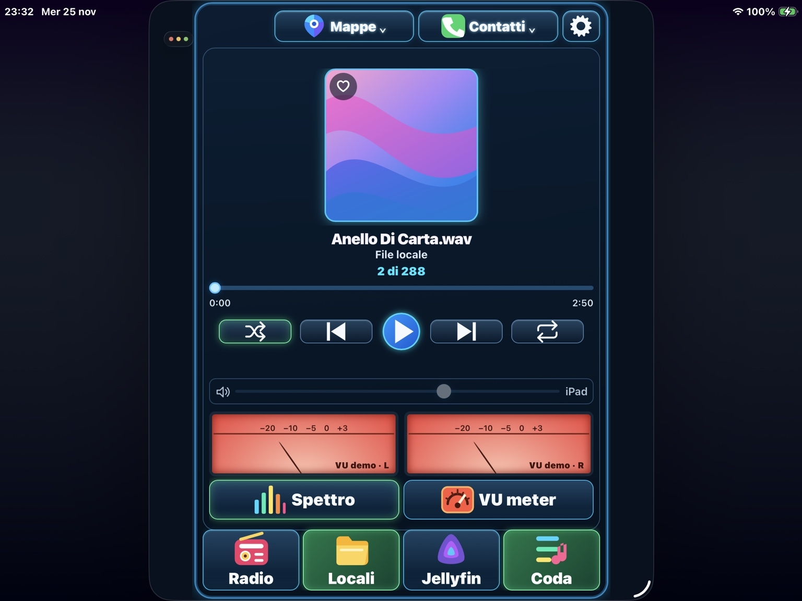
  </a> 
  <strong>1. Apri i controlli della finestra.</strong> Avvia Dompi dalla schermata Home, quindi tieni premuti i controlli della finestra o i pallini colorati in alto a sinistra finché compare il menu di disposizione.

  <a href="docs/installazione/02-menu-avvia-slide-over.jpeg">
    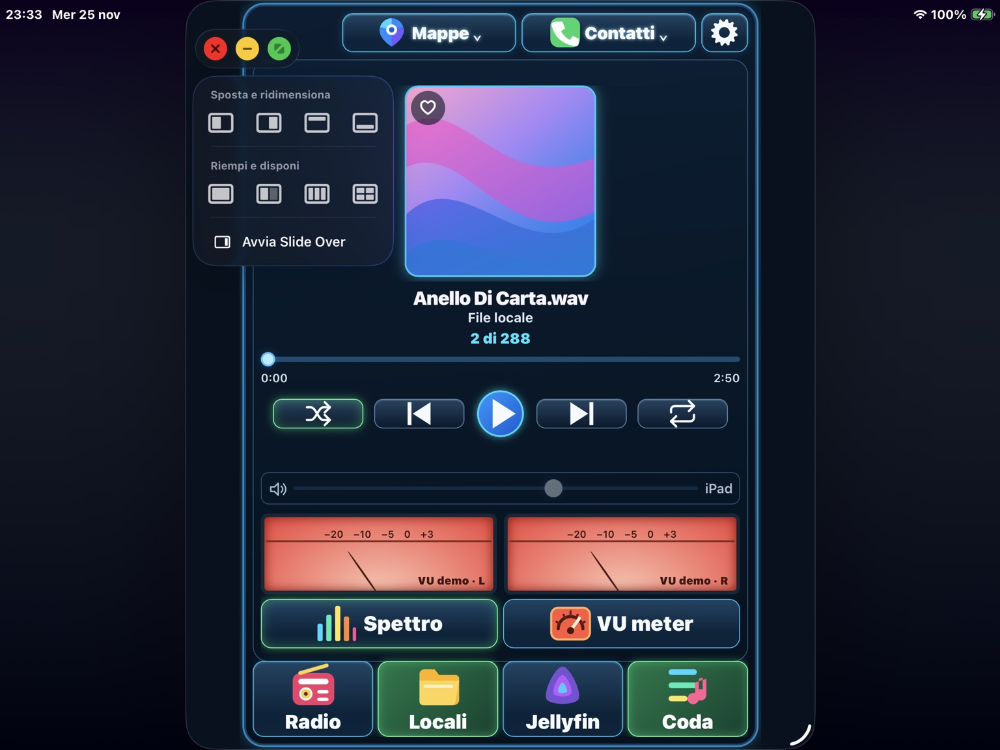
  </a> 
  <strong>2. Seleziona Avvia Slide Over.</strong> Tocca la voce <em>Avvia Slide Over</em> nel menu di disposizione di iPadOS.

  <a href="docs/installazione/03-dashboard-slide-over-destra.jpeg">
    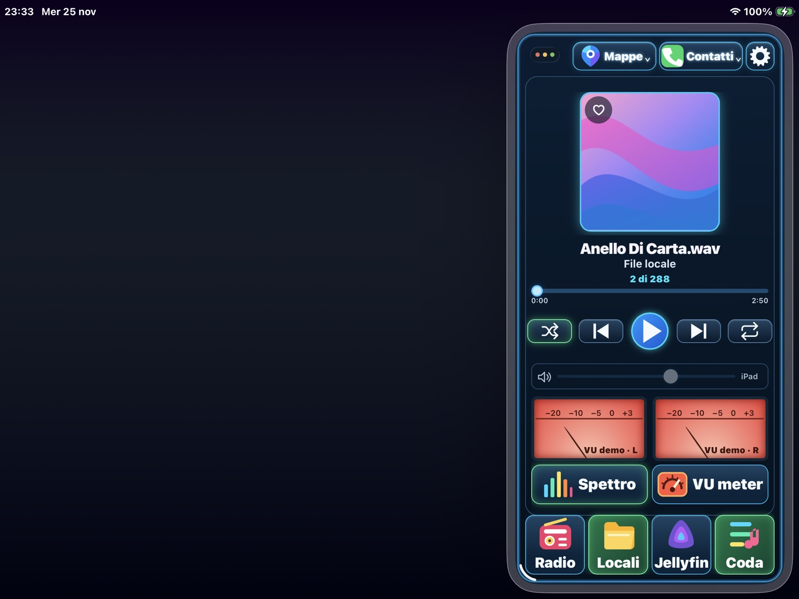
  </a> 
  <strong>3. Posiziona Dompi a destra.</strong> Apri l’app di navigazione sul lato sinistro e regola manualmente la posizione delle due finestre.

> Slide Over è una funzione del sistema operativo e dipende dal modello di iPad e dalla versione di iPadOS. Dompi non è CarPlay, non incorpora nativamente Waze, Google Maps o Mappe Apple e non può forzare la disposizione delle finestre di iPadOS. Configura la Dashboard e interagisci con i comandi soltanto a veicolo fermo.

<!-- gallery:start -->
<h2 id="dompi-car-dashboard-in-azione">Dompi Car Dashboard in azione</h2>

Dompi Car Dashboard è una PWA pensata per iPad, che consente di affiancare le app di navigazione a un lettore musicale con radio Internet, file locali e libreria Jellyfin. Le immagini mostrano l’interfaccia e un esempio di installazione reale in auto.

  <a href="docs/gallery/01-installazione-auto.webp">
    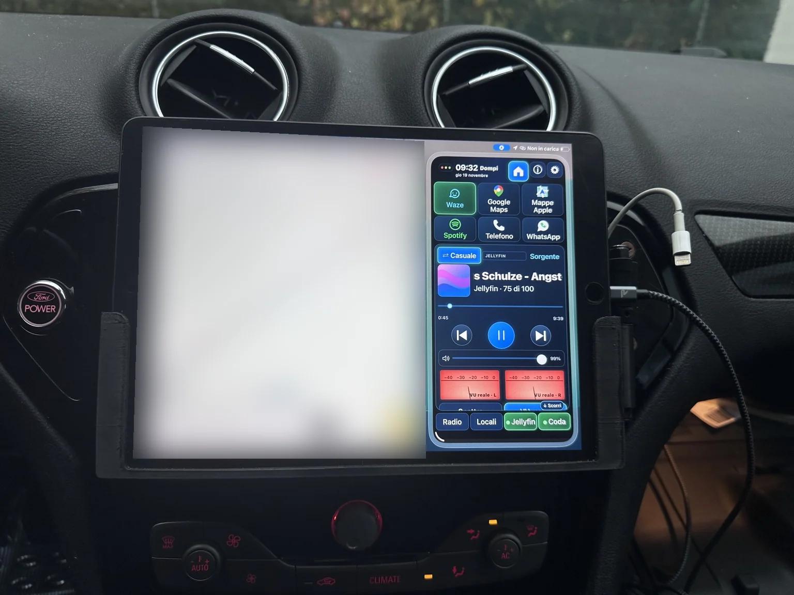
  </a> 
  <strong>Installazione reale in auto.</strong> iPad montato sul cruscotto, con navigazione e lettore affiancati. Foto di una versione precedente.

<blockquote>
  
Le mappe sono applicazioni esterne affiancate tramite le funzioni disponibili nel sistema operativo: Dompi non incorpora le app native e non è un’integrazione ufficiale CarPlay. Le aree cartografiche nelle fotografie sono state sfocate per tutelare la privacy.

</blockquote>

<h3>Interfaccia e funzioni</h3>

Seleziona una miniatura per aprire la fotografia a piena risoluzione.

<table>
  <tr>
    <td width="50%" valign="top">
      <a href="docs/gallery/02-musica-locale.webp">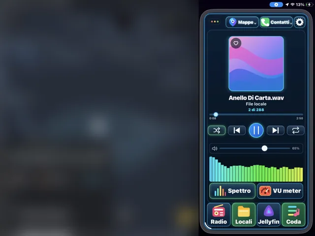</a> 
      <strong>Musica locale e navigazione</strong> 
      Riproduzione di file locali, contatore dei brani e spettro audio.
    </td>
    <td width="50%" valign="top">
      <a href="docs/gallery/03-scelta-mappe.webp">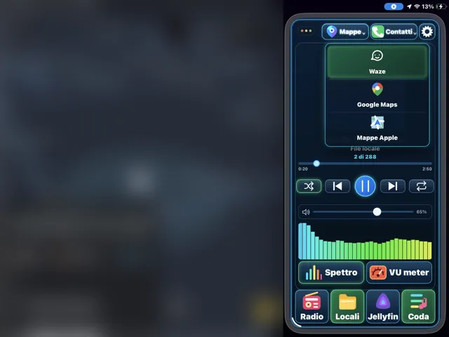</a> 
      <strong>Scelta delle mappe</strong> 
      Accesso rapido a Waze, Google Maps e Mappe Apple.
    </td>
  </tr>
  <tr>
    <td width="50%" valign="top">
      <a href="docs/gallery/04-contatti.webp">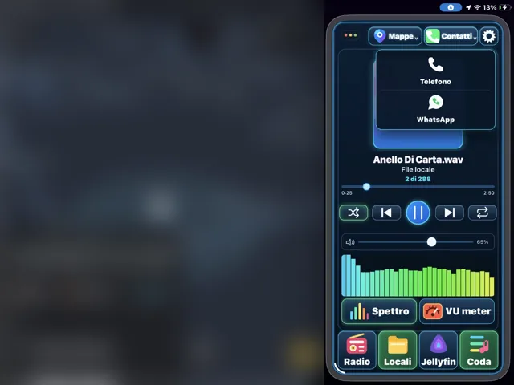</a> 
      <strong>Telefono e WhatsApp</strong> 
      Menu di accesso rapido alle applicazioni di comunicazione.
    </td>
    <td width="50%" valign="top">
      <a href="docs/gallery/05-radio.webp">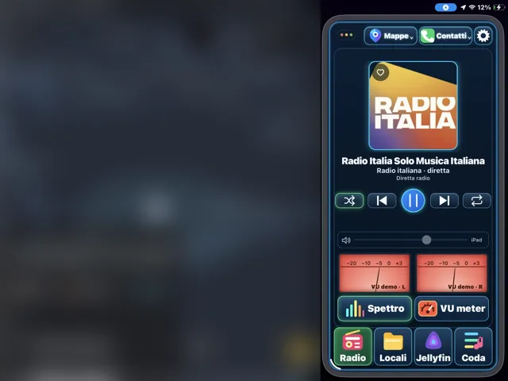</a> 
      <strong>Radio Internet</strong> 
      Radio in streaming con VU meter in modalità demo.
    </td>
  </tr>
  <tr>
    <td width="50%" valign="top">
      <a href="docs/gallery/06-jellyfin.webp">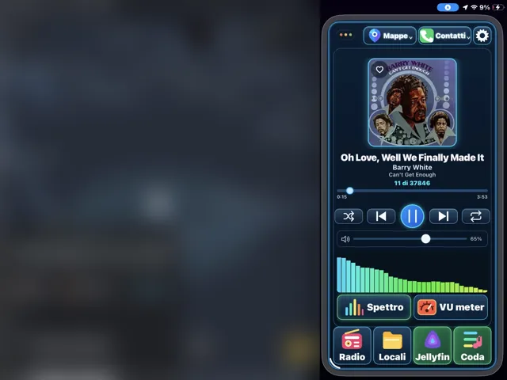</a> 
      <strong>Jellyfin</strong> 
      Riproduzione dalla libreria musicale personale, con copertina e spettro.
    </td>
    <td width="50%" valign="top">
      <a href="docs/gallery/07-vu-meter.webp">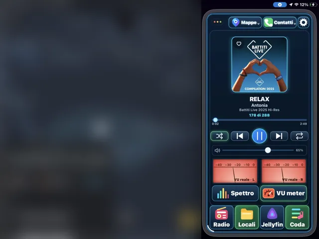</a> 
      <strong>VU meter stereo</strong> 
      Indicatori graduati dei canali sinistro e destro durante la riproduzione locale.
    </td>
  </tr>
</table>

<h3>Installazione reale in auto</h3>

  <a href="docs/gallery/08-supporto-ipad.webp">
    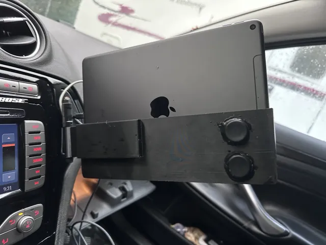
  </a> 
  <strong>Supporto per iPad.</strong> Vista posteriore del supporto utilizzato nell’installazione reale.

<blockquote>
  
La disponibilità delle app e dell’affiancamento dipende dal dispositivo e dal sistema operativo. Le fotografie non attestano compatibilità USB/iPod. Configurare la Dashboard e utilizzare i comandi soltanto a veicolo fermo, nel rispetto delle norme sulla circolazione e sulla sicurezza.

</blockquote>
<!-- gallery:end -->

## Utilizzo

La PWA si avvia con `index.html` su un sito HTTPS. I file sono pubblicati nella radice del repository per il corretto funzionamento di GitHub Pages. Funzioni di navigazione e applicazioni esterne dipendono dal dispositivo e dal browser.

Per Jellyfin, ciascun utente deve configurare il proprio server e il proprio account. Il server deve essere raggiungibile in HTTPS e autorizzare le richieste provenienti dall'origine della pagina tramite CORS. GitHub Pages non fornisce un proxy Jellyfin e l'accesso non è garantito senza configurazione dell'utente.

## Privacy e dati

I file pubblicati non includono credenziali preconfigurate. I dati inseriti nel browser dall'utente possono essere archiviati localmente dalla PWA, secondo le impostazioni dell'app. Non condividere file di backup contenenti credenziali.

## Diritti

Copyright © 2026 Domenico Pizzata. Tutti i diritti riservati.

Vedi il file `LICENSE` per le condizioni di utilizzo. Il software non è pubblicato con una licenza open source.

## Note

Questa copia è separata dalla versione distribuita su Aruba. La pubblicazione su GitHub Pages non aggiorna Aruba e viceversa.
